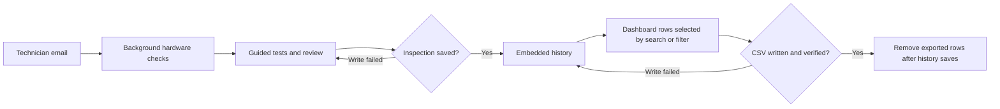

<div align="center">

# 🛠️ DQA Automation

**A portable Windows inspection tool for Dakota State University IT. Run laptop checks, record the result, and export the reviewed batch to an Excel-ready CSV from one PowerShell script.**


[Quick start](#quick-start) · [Inspection workflow](#inspection-workflow) · [CSV export](#dashboard-and-csv-export) · [Repository layout](#repository-layout)

</div>

---

## At a glance

| | What DQA does |
| --- | --- |
| **Hardware detection** | Reads the serial number and checks charging, network connectivity, connected displays and USB devices. It adds notes for findings such as a failing drive or low battery capacity. |
| **Guided tests** | Walks through camera, left and right speakers, microphone playback, keyboard, and touchscreen checks. Technicians can run them individually or start the sequence with **Auto-Test Hardware**. |
| **Portable settings** | Saves sound selection, test volume, touch targets, export destination, and other preferences inside the same writable script used for inspections. |
| **Saved history** | Shows inspection results in a searchable dashboard. A failed write keeps the current form available, and a window with older data cannot overwrite a newer save. |
| **Batch export** | Writes the displayed rows to a unique CSV, verifies the file, then removes those rows from the dashboard. |

## Quick start

Use a writable copy of [`DQA.ps1`](DQA.ps1) on Windows with **Windows PowerShell 5.1**. Right-click the file and select **Run with PowerShell**, or launch it from its folder.

```powershell
powershell.exe -NoProfile -STA -File ".\DQA.ps1"
```

A copy on a writable flash drive can travel between laptops with its saved settings and inspection history.

## Inspection workflow

1. **Identify the inspection.** Enter or select a technician email, then press **Enter** or **Tab** to start auto-detect. Confirm the serial number and manually verify any result that was left blank. A full battery on confirmed AC power can pass the charging check.
2. **Run the hands-on tests.** Select **Auto-Test Hardware** to follow the sequence. Listen for the left and right speaker cues, speak or clap when prompted, and tap the touchscreen targets directly on the screen.
3. **Review the results.** Complete the remaining hardware and cosmetic fields, review the diagnostic notes, and confirm the device was wiped down. A detected drive failure counts toward a **FAILED** verdict.
4. **Save.** Select **Save Inspection** and wait for confirmation before moving to the next laptop. Open the gear menu to change preferences. The Settings footer confirms successful automatic saves.

## Dashboard and CSV export

Open **Dashboard & History** to search by serial number, filter by result, or edit a saved inspection. Use the bottom scrollbar, a horizontal touchpad gesture, or **Shift + mouse wheel** to reach the rightmost columns.

**Export to CSV** uses the rows currently displayed. Choose a destination in Settings, or use the default removable-drive lookup with Desktop as the fallback.

| Export behavior | What to expect |
| --- | --- |
| **Filename** | Each batch gets a unique `DQA_Output_*.csv` name. |
| **Format** | The established 21-column layout stays compatible with Excel and the technician submission workflow. |
| **After a successful export** | DQA removes the verified rows from history. |
| **After a write error** | DQA keeps the rows in history. If the CSV was already created, the error message identifies where it was saved. |

Deleting a record or clearing history requires the admin PIN.

## How a record moves through DQA



The GUI is WPF, with the layout written in XAML. PowerShell handles the workflow and background CIM queries. Embedded C# handles the audio, keyboard, and horizontal scrolling integration.

## Keyboard shortcuts

| Shortcut | Action |
| --- | --- |
| `Ctrl+1` | Open Inspection |
| `Ctrl+2` | Open Dashboard & History |
| `Ctrl+S` | Save or update the inspection |
| `Ctrl+R` | Reset the form |
| `Ctrl+E` | Export the displayed rows |
| `Ctrl+F` | Focus dashboard search |
| `Ctrl+A` | Fill remaining fields when the form handles the shortcut |

## Repository layout

```text
.
├── DQA.ps1      Desktop app, hardware checks, and embedded data block
├── README.md    Technician workflow and maintenance notes
└── .gitignore   Root allowlist for these files
```

> [!IMPORTANT]
> A working copy of `DQA.ps1` can contain technician emails and inspection records in its embedded data block. Review that block before adding the script to Git or distributing a fresh copy. Use a clean copy for source control. CSV exports, backups, legacy scripts, and local materials are excluded by the allowlist.

## Validate the script

Use Windows PowerShell 5.1 to parse the script without opening the GUI or starting hardware tests.

```powershell
$errors = $null
[void][System.Management.Automation.Language.Parser]::ParseFile(
    (Resolve-Path -LiteralPath '.\DQA.ps1').Path, [ref]$null, [ref]$errors)
if ($errors) { $errors; exit 1 }
'DQA.ps1 syntax check passed.'
```

Use a separate writable copy and synthetic records when testing save or export behavior.

---

<div align="center">
<sub>Built for Dakota State University IT · Windows PowerShell · WPF · C#</sub>
</div>
